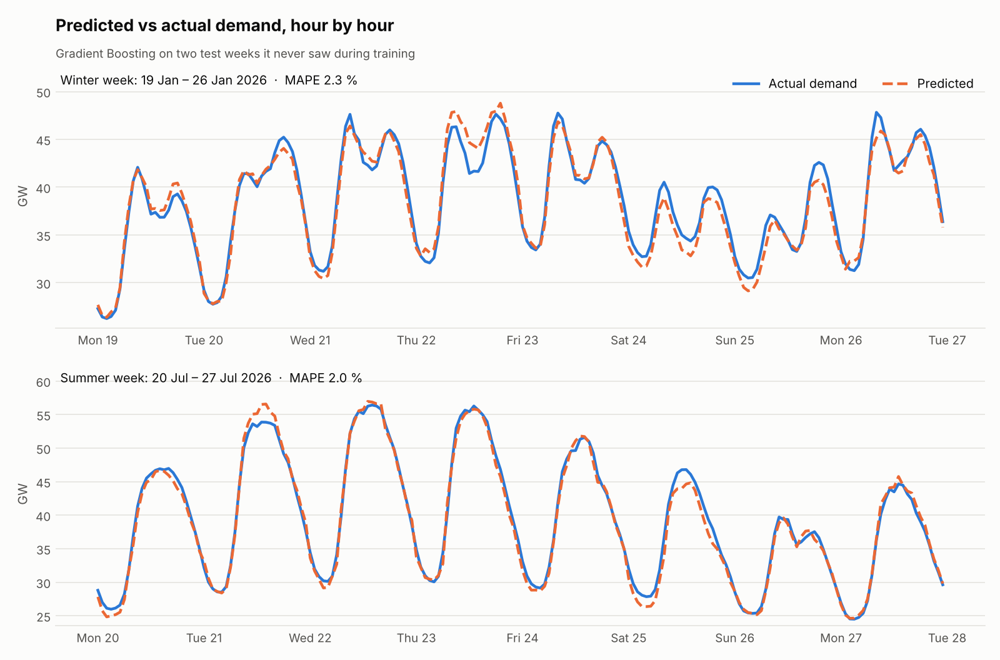
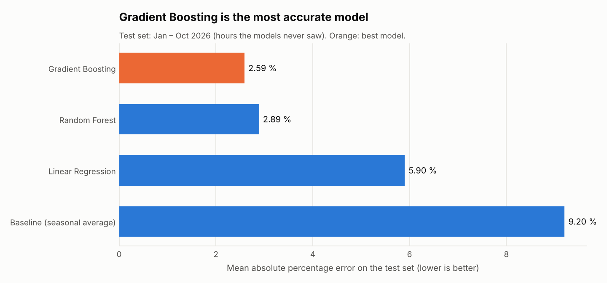
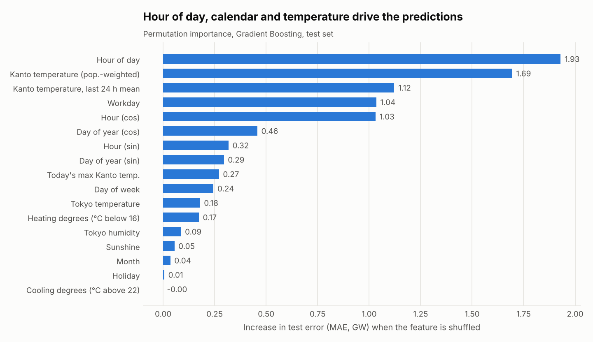
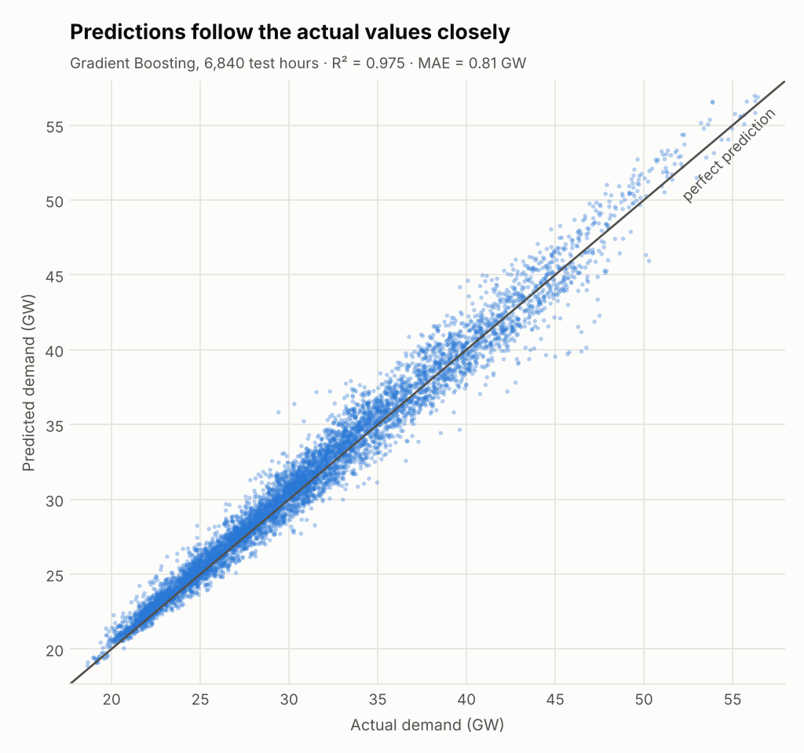
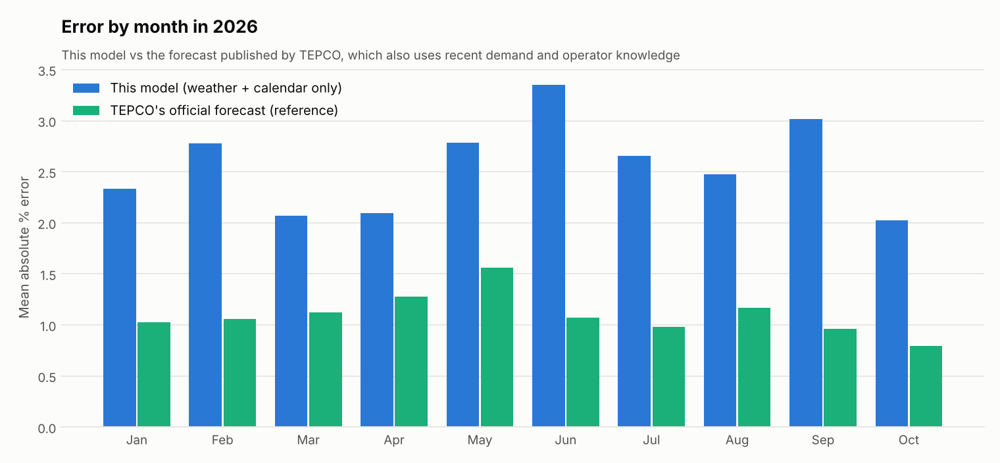

# Predicting Tokyo Electricity Demand with Machine Learning

This model predicts the **hourly electricity demand of the Tokyo (TEPCO) area** using only information known in advance: the **weather forecast** and the **calendar**. Grid operators use predictions like this to decide how many power plants to run.

- **Type:** supervised regression. The target is `demand_gw`, the hourly demand in gigawatts.
- **Data:** 39,744 hourly records from 1 Apr 2022 to 12 Oct 2026 (JST).
  - Demand: TEPCO Power Grid "でんき予報".
  - Weather: Japan Meteorological Agency (気象庁). Temperature, humidity and sunshine for Tokyo and a population-weighted Kanto average.
- **Tools:** Python, pandas, NumPy, scikit-learn, Matplotlib.

Data © TEPCO Power Grid and the Japan Meteorological Agency (processed). It was compiled through [kaseee/tokyo-grid-lab](https://github.com/kaseee/tokyo-grid-lab).

## Results

On the test set (Jan – Oct 2026, 6,840 hours the models never saw):

| Model | MAE (GW) | RMSE (GW) | MAPE | R² |
|---|---:|---:|---:|---:|
| Baseline (seasonal average) | 2.85 | 3.82 | 9.20 % | 0.689 |
| Linear Regression | 1.76 | 2.24 | 5.90 % | 0.893 |
| Random Forest | 0.90 | 1.25 | 2.89 % | 0.967 |
| **Gradient Boosting (best)** | **0.81** | **1.09** | **2.59 %** | **0.975** |
| *TEPCO official forecast (reference only)* | *0.35* | *0.52* | *1.12 %* | *0.994* |

**Gradient Boosting** predicts hourly demand with an average error of **2.6 %** and explains 97.5 % of the variation. That is 3.5 times more accurate than the seasonal-average baseline. TEPCO's own forecast is shown only as a reference: it also uses the latest actual demand and its operators' knowledge, which this model deliberately does not.





## How it was built

| Step | What was done |
|---|---|
| **1. Prepare the dataset** | Loaded the cleaned hourly data. Filled the few multi-day humidity gaps using the same hour on nearby days. Created time features (hour and day-of-year as sine/cosine), the last-24-hour average temperature and the day's maximum temperature. |
| **2. Select features** | 17 features, all known in advance: temperatures, **heating degrees** (°C below 16) and **cooling degrees** (°C above 22), humidity, sunshine, hour, day of week, month, workday and holiday. Past demand, solar output and TEPCO's forecast were **left out** to avoid data leakage. |
| **3. Train/test split** | Split **by date**, because this is time-series data: training covers Apr 2022 – Dec 2025 (32,904 hours, 83 %), and testing covers Jan – Oct 2026 (6,840 hours, 17 %). |
| **4. Train models** | A seasonal-average baseline, Linear Regression (with scaling and one-hot encoding in a scikit-learn `Pipeline`), Random Forest and Gradient Boosting (`HistGradientBoostingRegressor`). |
| **5. Generate predictions** | Predictions for every test hour (`test_predictions.csv`), plus `predict.py`, which predicts a full day from a date, a forecast max/min temperature and the day type. |
| **6. Evaluate** | MAE, RMSE, MAPE and R², permutation feature importance, and error by month. |

## Key findings

1. **Tree-based models win.** Gradient Boosting (2.6 %) and Random Forest (2.9 %) capture interactions such as "hot **and** workday **and** afternoon" that a linear model can't.
2. **Feature engineering matters.** Temperature alone correlates only weakly with demand (r = 0.21), because the effect is U-shaped. Adding heating- and cooling-degree features improved Linear Regression from **11.0 % to 5.9 %** error.
3. **The most important features** are the hour of day, the current Kanto temperature, the average temperature over the last 24 hours (heat builds up in buildings) and whether it's a workday.
4. **The biggest errors** happen in unusual situations: a very cold Sunday (8 Feb 2026, when demand was 6.6 GW above the prediction) and the start of the Obon holidays (12 Aug 2026, when demand was 6.4 GW below it).







## Example: predicting a new day

```bash
python predict.py 2026-08-10 35 27 Workday
```
```
2026-08-10 (workday), forecast 27.0–35.0 °C
Predicted peak: 54.7 GW at 13:00 | lowest: 25.7 GW | daily energy: 1012 GWh
```

## Files

All files are in one folder.

| File | Contents |
|---|---|
| `tokyo_demand_prediction.ipynb` | Notebook: every step with its outputs and charts. Start here. |
| `model.py` | Data preparation, features, split, training, evaluation and charts |
| `predict.py` | Uses the saved model to predict demand for any day |
| `demand_model.joblib` | The trained Gradient Boosting model |
| `model_comparison.csv`, `model_info.json` | Test metrics and model details |
| `test_predictions.csv` | Actual vs predicted demand for every test hour |
| `fig1_…png` to `fig5_…png` | Charts |
| `tokyo_hourly_clean.csv.gz` | The data |
| `requirements.txt` | Python packages |

## How to run

```bash
pip install -r requirements.txt
python model.py      # trains all models and saves the results (about 30 seconds)
python predict.py    # example predictions
```

## Possible improvements
- Add the previous day's demand as a feature. This is how operators get close to 1 % error.
- Use actual weather *forecasts* instead of observed weather, so the test reflects real conditions.
- Add special-day features for Obon, the New Year period and Golden Week.
